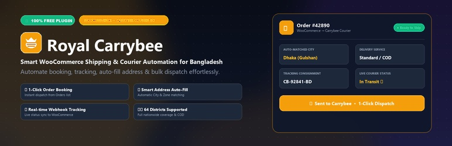

# Royal Carrybee - WooCommerce Shipping Integration




> ### 🎁 100% Free & Open Source Forever
> **Royal Carrybee is completely FREE!** There are **no subscriptions, no hidden fees, no credit cards required, and no locked pro features**. All features—including 1-Click bulk order booking, intelligent address auto-fill, real-time webhook parcel tracking, and multi-store management—are 100% accessible to every WooCommerce store owner in Bangladesh under the **GNU General Public License v2.0 (GPL-2.0)**.

A professional, high-performance WooCommerce shipping integration plugin for [Carrybee](https://carrybee.com) courier service in Bangladesh.

---

## 🚀 Features

- **100% Free & Open Source** - Every merchant gets full unlimited access to all features forever.
- **One-Click Order Dispatch** - "Sent to Carrybee" button in WooCommerce Orders list table (`edit.php?post_type=shop_order` & HPOS `wc-orders`) for instant 1-click booking without opening the order.
- **Smart Address Auto-Fill** - Intelligent city and zone matching from customer shipping/billing address on order edit page (uses state for city and city for zone to prevent spelling mistakes).
- **Address Preview & Badge** - Clean address preview summary card and visual `✨ Auto-filled` indicator inside order metabox.
- **WooCommerce Shipping Method** - Adds Carrybee as a native shipping option at checkout.
- **Cascading Location Dropdowns** - City → Zone → Area selection at checkout for error-free delivery addresses.
- **Auto Order Creation** - Automatically creates Carrybee parcel on order status change.
- **Bulk Actions** - Send multiple orders to Carrybee at once & Bulk Sync Status.
- **Real-time Tracking** - Consignment ID saved and displayed in custom table column.
- **Webhook Support** - Automatic real-time order status updates from Carrybee.
- **Multi-Store Support** - Manage multiple pickup warehouses/stores.
- **Sandbox Mode** - Seamlessly test with sandbox API before going live.
- **Admin Meta Box** - Tracking info and instant management directly inside the order edit page.
- **Email Integration** - Delivery tracking info included in customer notification emails.
- **Automatic Updates** - Seamless 1-click auto-updates delivered directly through WordPress admin.

---

## 📋 Requirements

- WordPress 5.6 or higher
- WooCommerce 5.0 or higher
- PHP 7.4 or higher
- Carrybee API credentials

---

## 📦 Installation

### Method 1: Upload via WordPress Admin
1. Download `royal-carrybee.zip` from [Releases](https://github.com/Royal-Technologies/royal-carrybee/releases).
2. Go to **WordPress Admin → Plugins → Add New → Upload Plugin**.
3. Select `royal-carrybee.zip` and click **Install Now**.
4. Click **Activate Plugin**.

### Method 2: Git Clone
Clone directly to your plugins folder:
```bash
cd wp-content/plugins/
git clone https://github.com/Royal-Technologies/royal-carrybee.git
```

---

## 🔄 Automatic Updates

Royal Carrybee comes equipped with built-in **GitHub Auto-Updates**:
- When a new release is published on the official repository [Royal-Technologies/royal-carrybee](https://github.com/Royal-Technologies/royal-carrybee), WordPress will notify you automatically in your **Plugins** dashboard.
- You can upgrade with a single click under **Plugins → Installed Plugins**.
- You can also enable native **Auto-updates** so your store stays up to date automatically!

---

## ⚙️ Configuration

### 1. API Credentials

1. Go to **WooCommerce → Carrybee** in your WordPress admin menu.
2. Select your environment (Sandbox / Production).
3. Enter your Carrybee API credentials:
   - Client ID
   - Client Secret
   - Client Context
4. Click **Test Connection** to verify your setup.

### 2. Shipping Zone Setup

1. Go to **WooCommerce → Settings → Shipping**.
2. Add or edit a shipping zone.
3. Add **Carrybee** shipping method.
4. Configure:
   - Flat rate amount
   - Free shipping threshold
   - Delivery type (Normal / Express)

### 3. Default Store

1. In Carrybee settings, go to the **Stores** tab.
2. Add or sync your pickup store(s).
3. Select a default store in **General Settings**.

---

## 🔗 Webhook Setup

To receive real-time order updates:
1. Copy the webhook URL from **WooCommerce → Carrybee**.
2. Provide it to Carrybee along with your webhook secret.
3. Carrybee will send status updates automatically.

Webhook URL format:
```
https://yourdomain.com/wp-json/royal-carrybee/v1/webhook
```

---

## 📍 Checkout Fields

The plugin automatically provides cascading location dropdowns at checkout:
- **City** - Dropdown of all Carrybee service cities
- **Zone** - Zones within selected city
- **Area** - Areas within selected zone

---

## 🧪 Sandbox Testing

Use these credentials for testing:

| Field | Value |
|---|---|
| Base URL | `https://stage-sandbox.carrybee.com` |
| Client ID | `1a89c1a6-fc68-4395-9c09-628e0d3eaafc` |
| Client Secret | `1d7152c9-5b2d-4e4e-9c20-652b93333704` |
| Client Context | `DzJwPsx31WaTbS745XZoBjmQLcNqwK` |

---

## 🔄 Webhook Events

The plugin handles these Carrybee events:

| Event | Action |
|---|---|
| `order.created` | Save fees and consignment info to order |
| `order.picked` | Add order note |
| `order.in-transit` | Add order note |
| `order.delivered` | Mark order completed |
| `order.delivery-failed` | Add note with failure reason |
| `order.returned-to-merchant` | Cancel order |
| `order.paid` | Save invoice ID |

---

## 🗂️ File Structure

```
royal-carrybee/
├── royal-carrybee.php                # Main plugin loader & updater init
├── royal-carrybee.json               # Auto-update version metadata
├── .github/workflows/release.yml     # Automated GitHub Release builder
├── includes/
│   ├── class-carrybee-api.php             # Carrybee API client
│   ├── class-carrybee-settings.php        # Settings panel
│   ├── class-carrybee-shipping-method.php # Shipping method
│   ├── class-carrybee-checkout.php        # Checkout fields
│   ├── class-carrybee-order.php           # Order dispatch & processing
│   ├── class-carrybee-webhook.php         # Real-time webhook handler
│   ├── class-carrybee-admin.php           # Admin UI, fast buttons, HPOS
│   └── class-carrybee-updater.php         # GitHub Auto-Updater
├── assets/
│   ├── images/                            # Banner & icon assets
│   ├── css/                               # Admin & frontend styles
│   ├── js/                                # Admin & checkout scripts
│   └── lib/                               # Select2, SweetAlert2
└── languages/                             # Translation files
```

---

## 🤝 Contributing

Contributions are welcome!
1. Fork the repository: [Royal-Technologies/royal-carrybee](https://github.com/Royal-Technologies/royal-carrybee)
2. Create your feature branch (`git checkout -b feature/amazing-feature`)
3. Commit your changes (`git commit -m 'Add some amazing feature'`)
4. Push to the branch (`git push origin feature/amazing-feature`)
5. Open a Pull Request

---

## 📄 License & Pricing

- **Price**: 100% FREE (No subscriptions, No premium unlocks)
- **License**: [GPL-2.0](LICENSE) - GNU General Public License v2.0 or later.

---

## 👨‍💻 Developer & Support

**Royal Technologies**
- Website: [royaltechbd.com](https://royaltechbd.com)
- GitHub: [Royal-Technologies](https://github.com/Royal-Technologies)
- Email: info@royaltechbd.com
- Phone: +880 1552-333272

---
Made with ❤️ by [Royal Technologies](https://royaltechbd.com)
